[Home - RAP130 - Build apps and web APIs with ABAP Cloud using agentic AI](../../README.md)

# Getting Started

## Introduction
Welcome to **RAP130**! 

Before building your app, you need to set up your development environment in Visual Studio Code and to connect it to your ABAP system.

In this exercise, you prepare your PC/laptop to run this tutorial.

---

**Table of Contents**
- [Introduction](#introduction)
- [Important Information](#important-information)
- [System and Logon Information](#system-and-logon-information)
- [Exercises](#exercises)
- [Summary & Next Exercise](#summary--next-exercise)

---

## Prerequisites

Ensure that you have installed a coding agent, e. g. [GitHub Copilot](https://github.com/features/copilot), with a **valid license**.

Ensure that your ABAP system contains and has access to the [ABAP Flight Reference Scenario](https://help.sap.com/docs/abap-cloud/abap-rap/abap-flight-reference-scenario).

---

### Exercises

- [0.1 - Install Visual Studio Code and the ABAP Development Tools Extension](#exercise-01-install-visual-studio-code-and-the-abap-development-tools-for-vs-code-extension)  
- [0.2 - Connect Visual Studio Code with the ABAP System](#exercise-02-connect-visual-studio-code-with-the-abap-system)
- [0.3 - Log on to the ABAP system](#exercise-03-log-on-to-the-abap-system)
- [0.4 - Define your Group ID](#exercise-04-define-your-group-id)
- [0.5 - Create your ABAP Package](#exercise-05-create-your-abap-package)
- [0.6 - Verify the Installation](#exercise-06-verify-the-installation)
- [0.7 - Explore the User Interface of Visual Studio Code for ABAP Development](#exercise-07-explore-the-user-interface-of-visual-studio-code-for-abap-development)
- [Summary](#summary)

---

<!--

Exercise 0.1 - Install Visual Studio Code
[^Top of page](#)

   > ℹ️ **Note**: For SAP events, the **Visual Studio Code** is already installed on your laptop. You need nothing to install at this point. 

> Install [Visual Studio Code](https://code.visualstudio.com/) as your open source AI code editor. Download and install it on your local drive.

<details>
  <summary>🔵 Click to expand!</summary>

1. Open the [download page](https://code.visualstudio.com/Download) page of VS Code Studio in your browser.

2. Select and download the installer of your operating system (Windows, macOS, or Linux).

   > ℹ️ **Note**: In this sample, Microsoft Windows is used as operating system for demo purpose.

      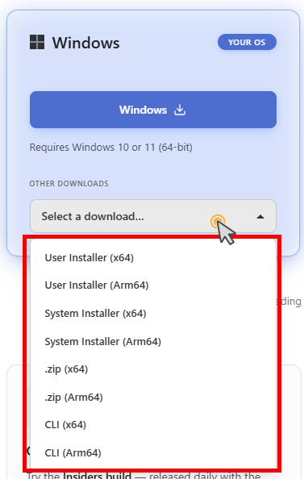  

      The installation file is downloaded in your default download folder
      
3. Select and run the installer and follow the on-screen instructions.

      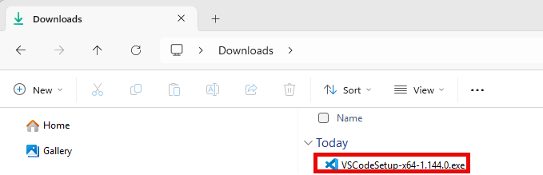

4. Launch **Visual Studio Code** once the installation is complete.

   > ℹ️ **Hint**: Ensure you are running a recent and stable version of Visual Studio Code. To check your version, go to **Help > About** in the menu. The version will then be displayed in a dialog to be opened.

</details>

---

## Exercise 0.2: Install the ABAP Development Tools for VS Code Extension
[^Top of page](#)

   > ℹ️ **Note**: For SAP events, the **ABAP Development Tools for VS Code** extension is already installed on your laptop. You need nothing to install at this point.  

>  The **ABAP Development Tools (ADT) for VS Code** extension is SAP's efficient and feature‑rich environment for ABAP development within the ABAP Cloud development model. Install it from the [**Microsoft Marketplace**](https://marketplace.visualstudio.com/items?itemName=SAPSE.adt-vscode) into your Visual Studio Code installation. This extension enables you for ABAP development and connects Visual Studio Code to your ABAP backend. It also includes the built-in ADT MCP Server and ADT MCP Tools.

<details>
  <summary>🔵 Click to expand!</summary>

### Step 1: Install from the Microsoft Marketplace

1. Open **Visual Studio Code**.

2. To open the **Extensions** view ...  
   a. Choose **`Ctrl+Shift+X`** (macOS: **`Cmd+Shift+X`**), or  
   b. Click the **Extensions** icon in the **Activity Bar** (left edge)

      

3. In the input field on top of the view, type and search for **`ABAP Development Tools`**.

      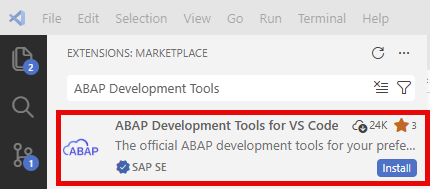

4. Select the **`ABAP Development Tools for VS Code`** extension published by **SAP** and click **Install**.

      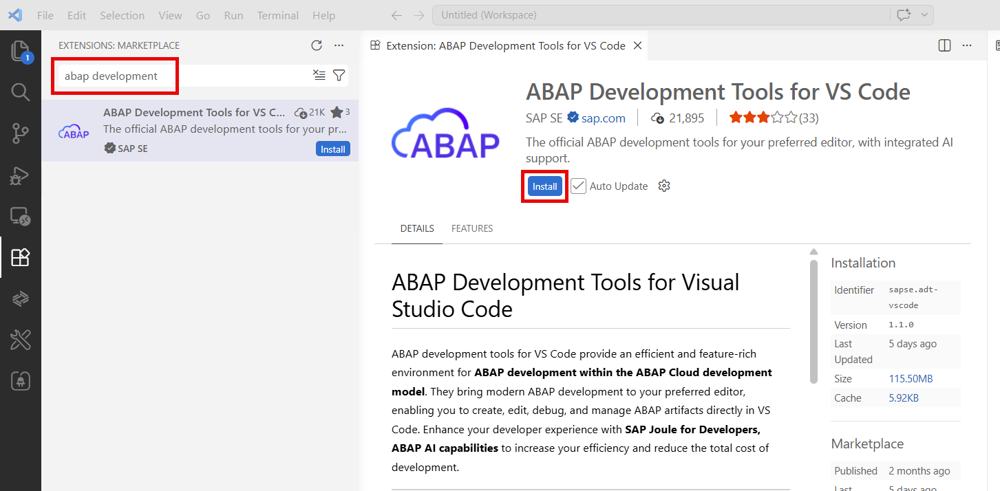

5. Wait for the installation to be completed.

The ADT extension should be installed and opens the **ABAP Development Tools for VS Code** page.

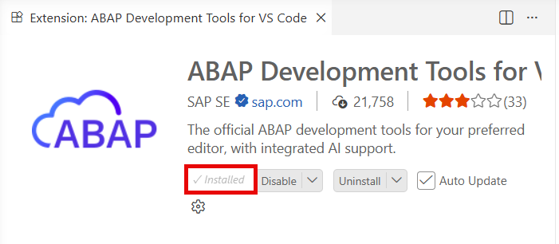  

   > ✅ **Success**: In the **Extensions** activity bar, you should see the `ABAP Development Tools` item listed under **Installed** extensions.   
   > Alternatively, you can enter `@installed` in the input field. You then get a list with the installed extensions.
  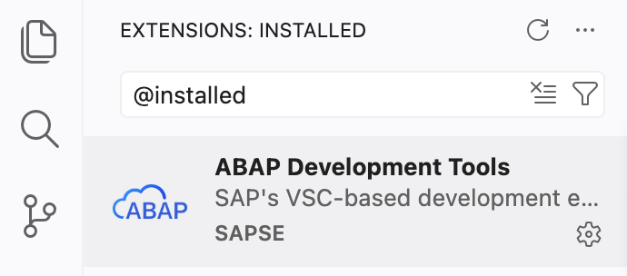
   
</details>

-->

---

## Exercise 0.1: Install Visual Studio Code and the ABAP Development Tools Extension
[^Top of page](#)

> ℹ️ **Info**: To install Visual Studio Code (VS Code) from the [VS Code download page](https://code.visualstudio.com/download) and the **ABAP Development Tools for VS Code** extension from the [Microsoft Marketplace](https://marketplace.visualstudio.com/items?itemName=SAPSE.adt-vscode), follow the steps 1 and 2 of the tutorial [ABAP Development Tools for Visual Studio Code](https://developers.sap.com/tutorials/abap-environment-adt-vscode/).

---

## Exercise 0.2: Connect Visual Studio Code with the ABAP System
[^Top of page](#)

> Open Visual Studio Code and create a **destination** to establish a system connection to your ABAP system. Add the destination to your workspace. 
>
> The following connection types are supported:
> - **HTTP** — SAP Business AI Platform or SAP S/4HANA Cloud Public Edition  
<!--
> - **RFC** — SAP S/4HANA or SAP S/4HANA Cloud Private Edition (requires SAP Logon configured on your machine)  
-->
>
>ℹ️ **Note**: Note that only SAP Business AI ABAP environment, SAP S/4HANA Cloud Public Edition, SAP S/4HANA Cloud Private 2025, 2023, 2022, 2021 Edition are currently supported for agentic AI-based ABAP development!

<details>
  <summary>🔵 Click to expand!</summary>

### <!--Option A: -->HTTP destination (Cloud systems)

1. To launch Visual Studio Code, double-click the Visual Studio Code shortcut on your desktop.

    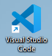

2. Open the **Command Palette** using **`Ctrl+Shift+P`** (macOS: **`Cmd+Shift+P`**).

3. Type 'ABAP: New Destination' and select **`ABAP: New Destination...`**.

4. Select **HTTP** as the connection type.

5. Enter the **System URL** to the ABAP system.  

    > ℹ️ **Note**: You can paste it from the clipboard into the command dialog in Visual Studio Code.

6. Press **`Enter`**. 

7. Type a short form as **ID** for the destination (e.g., 'RAP130').

8. Press **`Enter`**. 

   > ℹ️ **Note**: The connection is established and a dialog is opened on the right bottom for a few seconds. From here, you can add the destination directly to your workspace. 
   > 
   >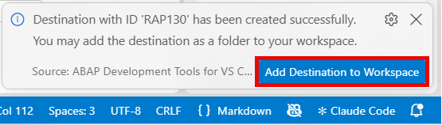  
   >  
   > If you have missed the dialog, you can choose **ABAP: Add Destination to Workspace...** from the **Command Palette** (**`Ctrl+Shift+P`** (macOS: **`Cmd+Shift+P`**)).

9. Choose the **`Add Destination to Workspace`** button.  

   The **Select a Destination** command dialog is opened.

   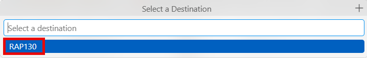

10. Select the destination 'RAP130' from the list and confirm with **Enter**.

The destination has been created and now appears in the **Workspace** in the **Explorer**.
  
  > ℹ️ **Note**: The **Explorer** is a part of the [Activity Bar](https://code.visualstudio.com/api/ux-guidelines/activity-bar) on the left. When you are logged on, it enables you to navigate through the ABAP system*.
  >
  > 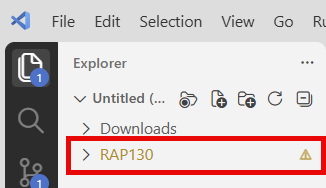  
  >
  > ℹ️ **Note**: You can display and edit the destinations as JSON file. To open the JSON file in the editor, choose **ABAP: Open Destination Settings (JSON)** from the Command Pallette (**`Ctrl+Shift+P`**).  
  >
  > 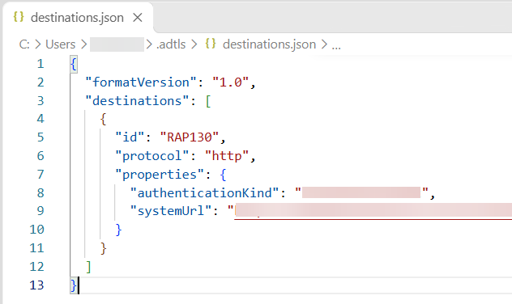

> ⚠️ Here is a summary of the relevant steps and data to be used: 

   ```
   Command Palette → 'ABAP: New Destination...'
     ↓
   Connection Type → HTTP
     ↓
   System URL → 'xyz'
           ↓
   Destination ID → 'RAP130'
     ↓
   Add destination to the workspace
     ↓
   ✅ Connection established and displayed in the Explorer!
   ```

<!-- 

### Option B: RFC destination (classic systems)

> ℹ️ **Prerequisite**: 
>- Your ABAP system* must be configured and added in **SAP Logon pad** (SAP GUI) with RFC connectivity before proceeding. 
>- Note that only SAP Business AI ABAP environment, SAP S/4HANA Cloud Public Edition, SAP S/4HANA Cloud Private 2025, 2023, 2022, 2021 Edition are currently supported for agentic AI-based ABAP development!

1. To launch Visual Studio Code, double-click the Visual Studio Code shortcut on your desktop.

    

2. Open the **Command Palette** using **`Ctrl+Shift+P`**.

3. Type 'ABAP: New Destination' and select **`ABAP: New Destination...`**.

4. Select **RFC** as the connection type.  

    A list of ABAP systems that is added in your **SAP Logon** configuration is displayed. 

5. Select your target system.

6. Enter your **`user name`** and press **`Enter`**.

7. Enter the **`client number`** (e.g., `100`) and press **Enter**.

8. Enter your **`logon language`** (e.g., `EN`) and press **Enter**.

9. Confirm or edit the name of destination.

10. Press **`Enter`**.  
  The connection is established and a dialog is opened. From here you can add the destination directly to your workspace.

   

11. Choose the **`Add Destination to Workspace`** button.  

    The **Selection** command dialog is opened.

12. Select the destination from the list and confirm with **Enter**.

The destination has been created and appears in the workspace in the **Explorer**.
  
  > ℹ️ **Information**: The **Explorer** is a part of the [Activity Bar](https://code.visualstudio.com/api/ux-guidelines/activity-bar) on the left.  
  > 

   ```
   Command Palette → 'ABAP: New Destination...'
     ↓
   Connection Type → RFC
     ↓
   System → S4D - Development System
     ↓
   Username → ABC
     ↓
   Client → 100
     ↓
   Language → EN
     ↓   
   Add destination to the workspace
     ↓
   ✅ Connection established!
   ```
-->

</details>

---

## Exercise 0.3: Log on to the ABAP system

>Log on to the ABAP system with your user credentials via the destination.

<details>
  <summary>🔵 Click to expand!</summary>

1. Select the created destination `RAP130` in the **Explorer** and choose **Log On to Destination...** from the context menu.      

   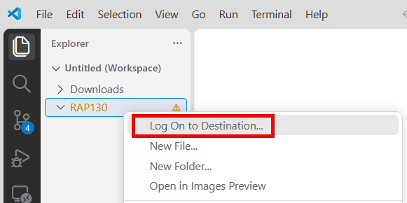

    > ⚠️ **Important**:  If the destination is **not** visible in the **Explorer**, proceed as follows:  
    a. Open the **Command Palette** using **`Ctrl+Shift+P`** (macOS: **`Cmd+Shift+P`**).   
    b. Type 'ABAP: Add Destination as Folder' and select **`ABAP: Add Destination as Folder to the Workspace...`**.  
    c. In the dialog to be opened, select the destination `RAP130` from the list.  
      
    d. Confirm the dialog with **`Enter`**.  
    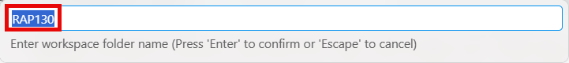  
    The destination becomes now visible in the **Explorer**.

3. The **Log On to ...** dialog is opened. Choose **Open with Default Browser**.

    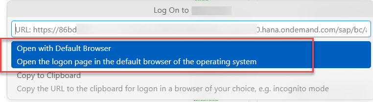


4. Confirm the the dialog of your operating syste to **Open** the URL in the default browser.

5. Confirm the logon credentials with **`Enter`**.

    The logon will be confirmed and your user will be logged on the ABAP system.

    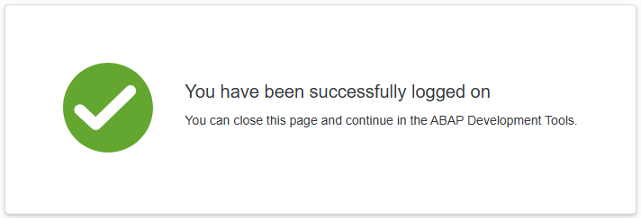

 5. Switch back to Visual Studio Code.

    The system structure of your destination becomes available in the **Explorer**.

    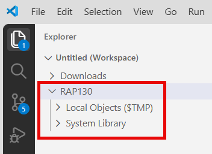 

</details>

---

 ## Exercise 0.4: Define your Group ID
[^Top of page](#)

> Define a group ID that you will need throughout this workshop to uniquely identify your repository artifacts and avoid conflicts with other participants using the same system.

> ⚠️ **Do not** use group ID **`000`**. Choose your initials or a number combination that is unique to you.

> ⚠️ For SAP-led workshops, a group ID **`###`** will be provided by the instructor.

<details>
  <summary>🔵 Click to expand!</summary>

As the ABAP environment is shared with many participants, every artifact you create follows a naming pattern using a personal suffix.

You will find the placeholder **`###`** in all object names throughout the exercises. Replace it with your group ID.

The group ID can contain **a maximum of 3 characters (numbers and/or letters)** — e.g. `123`, `XY1`, or `ABC`.

**Check for already-used group IDs:**

To go for sure, ...

1. Once Visual Studio Code is connected, open the **Command Palette** with **`Ctrl+Shift+P`** (macOS: **`Cmd+Shift+P`**).

2. Type **`ABAP: Open Object`** and press **Enter**.

3. Search for **`ZRAP130_###`**, replacing `###` with your chosen suffix. If results appear, the group ID is already taken — try another one.

4. _No results_ means the group ID is available. Note it down and use it consistently throughout all exercises.

</details>

---

<!--

## Exercise 0.5: Open your ABAP Package 
[^Top of page](#)

> For this tutorial, the ABAP package `ZRAP130_###` has already been created for you.

> ℹ️ **Note**: Replace **`###`** with your group ID.

<details>
  <summary>🔵 Click to expand</summary>

1. Choose **`Ctrl+Shift+A`** to search and to open it.

2. Enter the **`ZRAP130_###`** for the name of your ABAP package.

3. Select the relevant package in the proposal list.

The package will be opened in the **Explorer**.

</details>

-->

## Exercise 0.5: Create your ABAP Package 
[^Top of page](#)

> Create your exercise ABAP package.

> ℹ️ **Note**: 
>- For this course, create your new package into the existing superpackage **'ZRAP130_INTERN'** under 'ZLOCAL'.
>- Replace **`###`** with your group ID.

<details>
<summary>🔵 Click to expand</summary>

1. In Visual Studio Code, open the **Command Palette** and type 'ABAP'. 

2. Choose **ABAP: Create New ABAP Object...** from the list.
 
   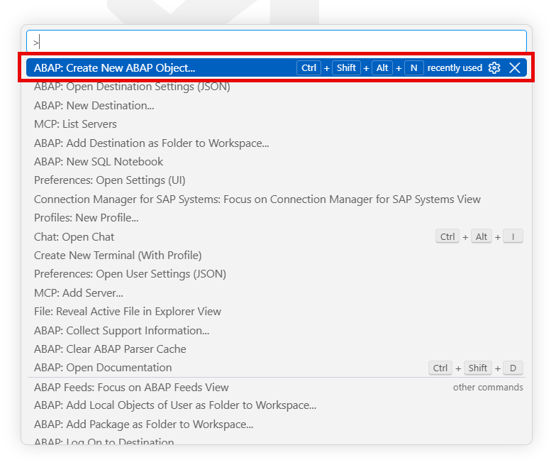

3. Type 'package' and select **`Package Type: DEVC/K`** from the list.

   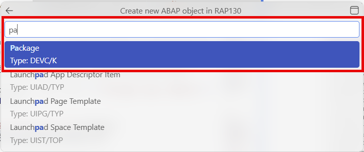

4. Enter the following details:
   - **Name**: `ZRAP130_###` (replace `###` with your group ID)
   - **Description**: `RAP130 AI Package ###`
   - **Super Package**: `ZRAP130_INTERN` (Alternatively, you can also use `ZLOCAL`!)
   - **Software Component**: - (Leave this field blank!)

   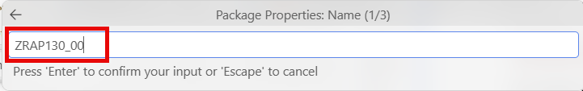

5. Click **Enter** to trigger package creation.
   
6. Verify if your package **`ZRAP130_###`** appears in the **Explorer**.

>ℹ️ **Note**: If the package does **not** appear in the **Explorer**, open the **Command Palette** with **`Ctrl+Shift+P`** (macOS: **`Cmd+Shift+P`**). Type '>ABAP: Add Package as Folder to Workspace' and press **Enter**. Select then the relevant destination from proposal list and confirm with **Enter**. 

</details>

---

## Exercise 0.6: Verify the Installation

Get familiar with the [**ABAP Developemnt Tools for VS Code**](https://help.sap.com/docs/abap-cloud/abap-development-tools-for-visual-studio-code/abap-development-tools-for-visual-studio-code) extension.

<details>
 <summary>🔵 Click to expand!</summary>

1. Open the **Command Palette** and type 'ABAP'.  

    You should see ABAP-specific commands such as:
    - `ABAP: New Destination...`  
    - `ABAP: Add Destination as Folder to Workspace` 
    - `ABAP: Open Object...` 
    - `ABAP: Create New ABAP Object...` 
    - `ABAP: Activate` 
    - ...


    >✅ If you see these commands, the extension is installed correctly.  

    >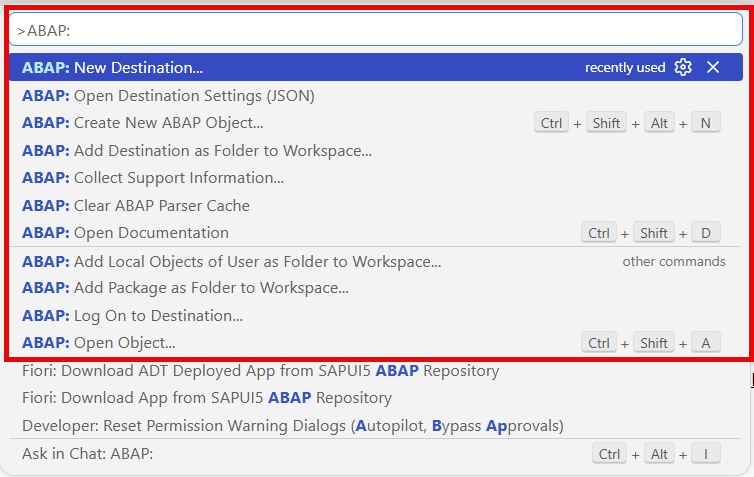  

</details>

---

## Exercise 0.7: Explore the User Interface of Visual Studio Code for ABAP Development
[^Top of page](#)

> Get familiar with the key Visual Studio Code areas and its [user interface](https://code.visualstudio.com/docs/editing/getting-started/userinterface) of VS Code.

<details>
  <summary>🔵 Click to expand!</summary>

### Key UI areas for ABAP development

| Area | Location | Purpose |
|------|----------|---------|
| **Activity Bar** | Far left | To switch between Explorer, Search, Source Control, Run & Debug, Extensions |
| **Command Palette** | At the top | To trigger features and functions |
| **Explorer (Workspace)** | Left sidebar | To navigate your ABAP system hierarchy — packages, object types, objects |
| **Editor** | Center | To edit ABAP source code (classes, CDS views, behavior definitions, etc.) |
| **Coding agent chat** (e.g. GitHub Copilot) | Right sidebar or panel | AI-powered **Chat** view. You will run MCP tool prompts here. |
| **Outline** | Left sidebar | For navigation within the structure of ABAP classes and interfaces |
| **Problems** panel | Bottom | Syntax errors and warnings |
| **Terminal** panel | Bottom | Integrated shell |
| **Status Bar** | Very bottom | Current line/column, language, connected system |

> **Further reading**: [User Interface](https://code.visualstudio.com/docs/editing/getting-started/userinterface)

### Essential keyboard shortcuts

| Action | Windows/Linux | macOS |
|--------|---------------|-------|
| Command Palette | **`Ctrl+Shift+P`** | **`Cmd+Shift+P`** |
| Open ABAP Object | **`Ctrl+Shift+A`** | **`Cmd+Shift+A`** |
| Create ABAP Object | **`Ctrl+Shift+Alt+N`** | **`Cmd+Shift+Option+N`** |
| Activate object | **`Ctrl+F3`** | **`Cmd+F3`** |
| Activate all inactive objects | **`Ctrl+Shift+F3`** | **`Cmd+Shift+F3`** |
| Save | **`Ctrl+S`** | **`Cmd+S`** |
| Find/Replace | **`Ctrl+H`** | **`Cmd+H`** |
| Run ABAP Unit Tests | **`Ctrl+Shift+F10`** | **`Cmd+Shift+F10`** |
| Open Documentation | **`Ctrl+Shift+D`** | **`Cmd+Shift+D`** |

> ℹ️ **Note**: 
>- Use **Find/Replace** (**`Ctrl+H`**) to replace all occurrences of `###` with your group ID at once in any file. For more information, see [Keyboard Shortcuts for ABAP Development](https://help.sap.com/docs/abap-cloud/abap-development-tools-for-visual-studio-code/keyboard-shortcuts-for-abap-development)
>- The tutorial is based on Microsoft Windows as operating system. For macOS, use the `Cmd` key instead of the `Ctrl` key. 

### Navigating within your ABAP system

You have the following possibilities:

1. In the **Explorer**, expand the **System Library** folder of your destination.

2. Navigate through the package hierarchy to find ABAP development objects.

3. Use **`Ctrl+Shift+A`** to quickly open any object by name. You can use wildcards, for example,  asterisk '*' search for `*RAP*`.

4. To activate, choose **`Ctrl+F3`** for single activation or **`Ctrl+Shift+F3`** for mass activation.

    > ℹ️ **Note**: Objects with unsaved backend changes are marked **(L)**. They must be **activated** to become active in the ABAP system. 

</details>

---

## Summary & Next Exercise
[^Top of page](#)

You have successfully:
- Installed **Visual Studio Code** and the **ABAP Development Tools for Visual Studio Code** extension (which includes the ADT MCP server)
- Created a destination and connected Visual Studio Code to your ABAP system
- Defined your group ID (`###`) for artifact naming
- Created an ABAP package
- Added the destination to your workspace and authenticated
- Verified and explored the **Visual Studio Code** areas and features for ABAP development

You can continue with the next exercise:   
— **[Exercise 1: Get-to-Know and Verify the Enablement of the ADT MCP Server](../ex01/README.md)**

---