[Home - RAP130 - Build apps and web APIs with ABAP Cloud using agentic AI](../../README.md)

# Exercise 1: Enable the ADT MCP Server

## Introduction
The [Model Context Protocol (MCP)](https://modelcontextprotocol.io/docs/2026-07-28/getting-started/intro) is an open-source standard that allows AI models to securely communicate with external tools, applications, and data sources through a common protocol.

The **ABAP Development Tools for Visual Studio Code** (ADT) extension contains the **ADT MCP server** as a local HTTP server that runs inside the ADT extension. It implements the Model Context Protocol (MCP) to call ADT MCP tools in a structured, authenticated way and exposes ABAP development capabilities as ADT MCP tools. 

This means, the ADT MCP server exposes a set of ABAP development tools (so-called ADT MCP tools) to any MCP-compatible AI assistant. This allows you to create packages, to create transport requests, to generate complete RAP applications, activate objects, and more through natural language prompts.  

## Procedure 
At first, you need to [enable the ADT MCP server](https://help.sap.com/docs/abap-cloud/abap-development-tools-for-visual-studio-code/enabling-adt-mcp-server) in the settings of your ABAP Development Tools (ADT) extension manually. Otherwise, the coding agent has no access to the ADT MCP tools.  

You will use your coding agent in **Agent** mode together with the ADT MCP tools to generate a RAP UI service using the ABAP Cloud Generator and to create a complete transactional app ('Travel' + 'Booking' entities)—all driven by natural language prompts using the coding agent provided in the **Chat** view.  

>ℹ️ **Note**:  This hands-on session uses [**GitHub Copilot**](https://docs.github.com/en/copilot/get-started/quickstart) as coding agent. You can also use other Chat-based coding agent as well as Command Line Interface (CLI)-based coding agents, such as [Claude Code](https://marketplace.visualstudio.com/items?itemName=anthropic.claude-code).

> ⚠ **Warning regarding AI outputs** ⚠  
> The ADT MCP server is an **experimental feature** that may change at any time without notice. It is not intended for productive use. Please back up your data before using it.

### Further Information
- [ADT MCP Tools](https://help.sap.com/docs/abap-cloud/abap-development-tools-for-visual-studio-code/mcp-tools?locale=en-US) 
- [Model Context Protocol (MCP)](https://modelcontextprotocol.io/)
- [ADT Security Considerations and Recommendations](https://help.sap.com/docs/abap-cloud/abap-development-tools-for-visual-studio-code/security-recommendations-and-considerations)  
- [Agentic AI for ABAP Development](https://help.sap.com/docs/abap-cloud/abap-development-tools-for-visual-studio-code/agentic-ai-development?locale=en-US)  

---

## Prerequisites

 To work with agentic-based ABAP development, you need to install a supported coding agent and to purchase a license for it. 
 
 This hands-on session is based on [GitHub Copilot](https://github.com/features/copilot).  

---

### Exercises

- [1.1 - Enable the ADT MCP Server](#exercise-11-enable-the-adt-mcp-server)
- [1.2 - Enable the ADT Edit File Tool to Modify ABAP Development Objects When Using CLI-Based Coding Agents](#exercise-12-enable-the-adt-edit-file-tool-to-modify-abap-development-objects-when-using-cli-based-coding-agents)
- [1.3 - Add the Destination and ABAP Package to the Allowlist](#exercise-13-add-the-destination-and-abap-package-to-the-allowlist)
- [1.4 - Verify the ADT MCP Server is Running](#exercise-14-verify-the-adt-mcp-server-is-running)
- [1.5 - Verify the Availability of the ADT MCP Tools in the Chat View](#exercise-15-verify-the-availability-of-the-adt-mcp-tools-in-the-chat-view)
- [Summary & Next Exercise](#summary--next-exercise)

---

## Exercise 1.1: Enable the ADT MCP Server
[^Top of page](#)

> Enable the settings of the built-in ADT MCP server in the ADT extension.


<details>
  <summary>🔵 Click to expand</summary>

1. Open the **Command Palette** with **`Ctrl+Shift+P`** (macOS: **`Cmd+Shift+P`**).

2. Type **Preferences: Open Settings (UI)** and select the finding from the list.

   The **Settings** landing page is opened. Click into the search bar.
   
   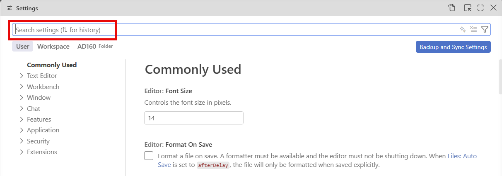

2. In the search bar, type:

   ```
   adt mcp
   ```
   The findings in the **Extensions > ABAP Development** node are displayed.


3.  Locate the **Adt: Enable MCP Server** setting (or similar) and select the checkbox.

      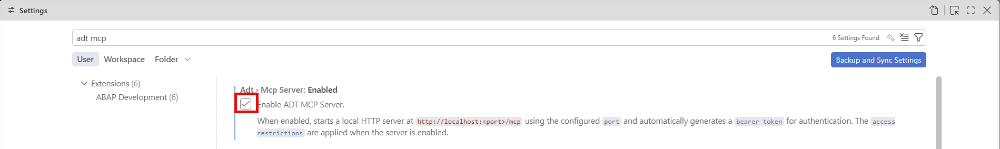
<!--
   ℹ️ **Hint**: You can also switch to JSON mode (click the '{}' icon top-right in settings) and add:  
   
   ```
   json 'adt.mcpServer.enabled': true  
   ```
   -->

4. [Optional:] If relevant, you can configure the **MCP server port** manually.   
   > ℹ️ **Note**: The default is '2236'. Only change this if port '2236' is occupied on your machine. Proceed then as follows:  
   a. Search for **ADT MCP port** in the settings.   
   b. Set it to the relevant port between '0' and '65535'.

   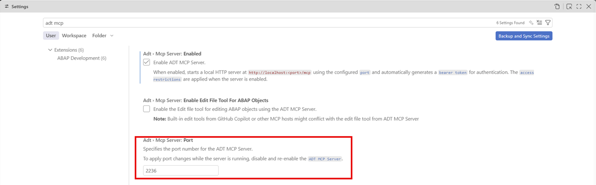
   

5. To make the enablement effective, choose **Reload Visual Studio Code** if prompted, or close and reopen Visual Studio Code.

   > ⚠️ **Important**: 
   >- Make sure your destination is still added to the workspace and you are logged on to the ABAP system. The ADT MCP server only starts once a destination is active in the workspace.
   >- When starting the ADT MCP server, a token is initially generated and will be used to access the ADT MCP server. When enabling the checkbox from above the first time, it may take a few seconds until the token will be generated and displayed.  
   > 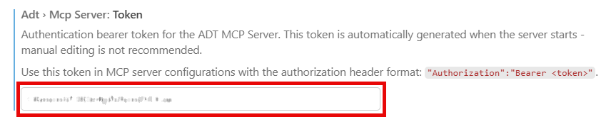  
   
</details>

---

## Exercise: 1.2 Enable the ADT Edit File Tool to Modify ABAP Development Objects When Using CLI-Based Coding Agents
[^Top of page](#)

> (Optional:) You can allow native edit tools of the coding agent to edit ABAP development objects.  


> ℹ️ **Important Note**: This setting is only relevant when you use a CLI-based coding agent, e. g. Claude Code. If you miss selecting this checkbox, ADT for VS Code is using a virtual file system implementation which **cannot** be accessed by the native edit tools of the coding agent. In this case, also the correct transport handling is **not** ensured. 
> This setting is **not** relevant when you use the Chat-based coding agents, such as GitHub Copilot.

<details>
  <summary>🔵 Click to expand</summary>
  
1. Reopen the ADT MCP settings. See [Enable the ADT MCP Server](#exercise-11-enable-the-adt-mcp-server)

2.  Locate the **Adt > Mcp Server: Enable Edit File Tool For ABAP Objects** setting (or similar) and select the checkbox.

      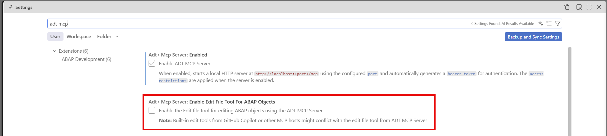

 The checkbox is marked as selected. Now, CLI-based coding agents can edit ABAP development objects. 
 
 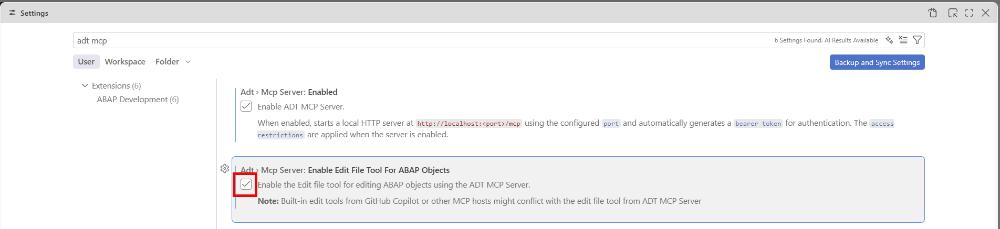

</details>

---

## Exercise: 1.3 Add the Destination and ABAP Package to the Allowlist
[^Top of page](#)

> Allow the ADT MCP tools to access the development objects in your ABAP package through your destination.
   
   > ℹ️ **Note**: To enable ADT MCP tools access to destinations, packages, and namespaces, you need to add them to the respective allowlist. Otherwise, the ADT MCP tools have no access to the development objects.

<details>
  <summary>🔵 Click to expand</summary>

1. Reopen the ADT MCP settings. See [Enable the ADT MCP Server](#exercise-11-enable-the-adt-mcp-server)

2.  Locate the **Adt > Mcp Server: Access Restrictions Enabled** setting (or similar) and select the checkbox.

   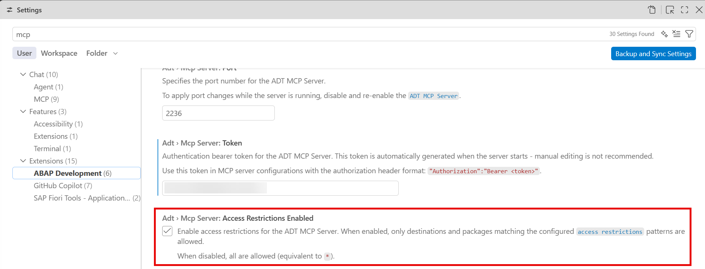

3.  In the section **Adt > Mcp Server: Access Restrictions**, check the **Edit** icon for the **Item** 'destinations' and enter the name of the destination as **Value**. 

   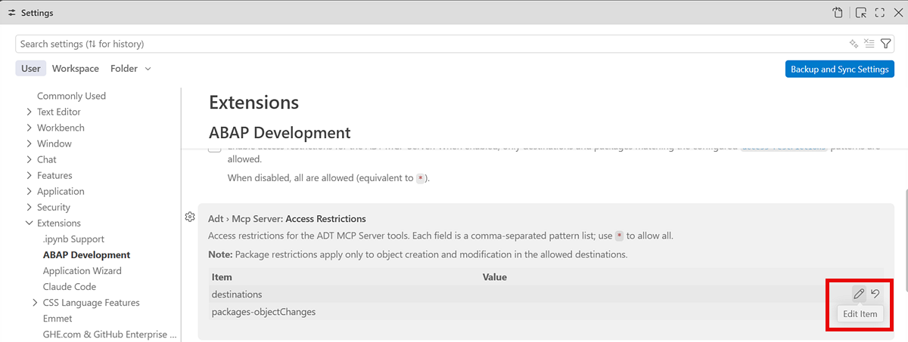


4. Enter the name of the ABAP package for the **Item** 'packages-objectChanges' as **Value** on the same way.

   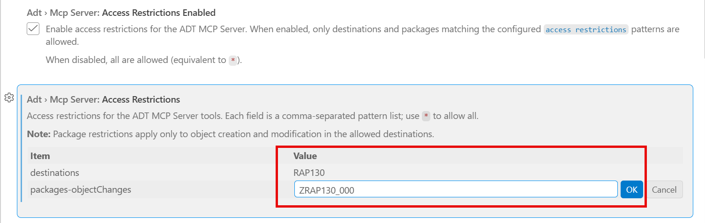

5. Confirm with **OK**.

The destination and the ABAP package are added to the allowlist and can now be accessed through the ADT MCP server.

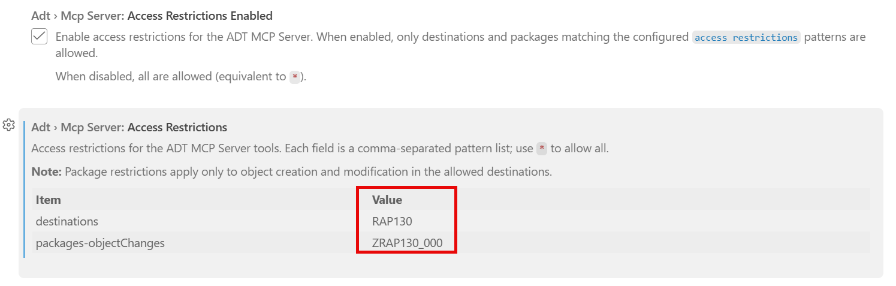

</details>

---

## Exercise: 1.4 Verify the ADT MCP Server is Running
[^Top of page](#)

> Check and verify that the ADT MCP server has been started and is running.

> ℹ️ **Note**: To use the ADT MCP tools in ADT for VS Code, the ADT MCP Server needs to run. 

<details>

You have the following methods for verification:

**Method 1: Check for the startup notification**

1. Look at the bottom-right corner for a notification in the status bar.

2. Select the **Notifications** icon with the bell from the status bar on the right bottom.

   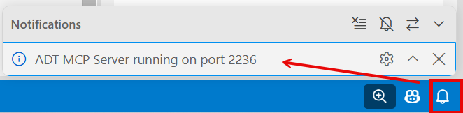

**Method 2: Check using the MCP server list**

1. Open the **Command Palette** (**`Ctrl+Shift+P`**).

2. Type ...  

   ```
   >MCP:List Servers
   ```

3. Select **`MCP: List Servers`** from the list.  

    You should see an entry for **ADT MCP Server** in the quick pick list.
   
   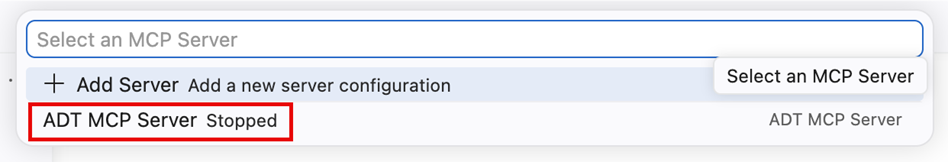

4. If the **ADT MCP Server** is stopped, select the entry and choose **Start Server**.

   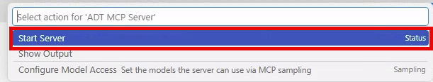

   After selection, the ADT MCP server is displayed as running.

   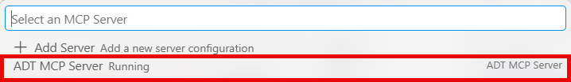


**Method 3: Check the display in the Output view**

1. Open the **Output** view beneath the editor.

   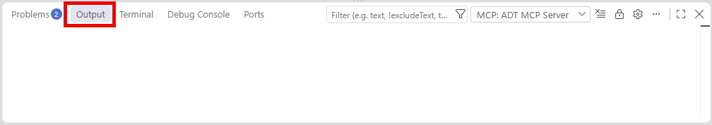

2. Select **MCP: ADT MCP Servers** from the drop-down list in the integrated toolbar.

   Then, the status will be displayed in the **Output** view.

   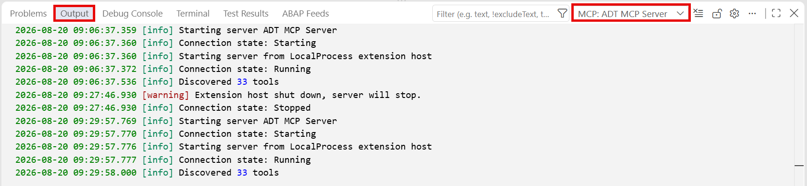

---

### Troubleshooting*

If the ADT MCP server does not appear or fails to start:

1. Disable and re-enable the **Adt: Enable MCP Server** setting.

2. Remove the destination folder from the workspace by choosing **Remove Folder from Workspace** from the context menu. 

<!--
   > ℹ️ **Hint**: In addition, you can also run **>ABAP: Open Destination Settings (JSON)** from the Command Palette and remove the relevant enty. Restart then Visual Studio Code. You then need to create and add the destionation once again.
-->

3. Add it back from the command palette (**`Ctrl+Shift+P`** (macOS: **`Cmd+Shift+P`**)) and choose **Add Destination as Folder to Workspace**.

3. Type ...
   ```
   ABAP: Add Destination as Folder to the Workspace...
   ```

4.  Select **`>ABAP: Add Destination as Folder to the Workspace...`** from the list. 

5. Enter/select the name of the destination and confirm.

6. Restart Visual Studio Code.

</details>

---

## Exercise: 1.5 Verify the Availability of the ADT MCP Tools in the Chat View
[^Top of page](#)

> Open the **Chat** view of your coding agent in the agent mode. Confirm that the ADT MCP tools are available.

<details>


1. If the **Chat** view is not displayed by default, open the GitHub Copilot **Chat** view in Visual Studio Code.  

   You have the following possibilities to do this:  
    >- Click the **Copilot** icon in the **Activity Bar** (left), **or**
    >- choose *`View`* > *`Chat`* from the menu, **or**
    >- press **`Ctrl+Shift+I`** (macOS: **`Cmd+Shift+I`**)  

2. Click the **Configure Tools** (tools wrench icon) button in the Copilot chat input bar.  
   A quick pick list appears showing available tool providers. 

      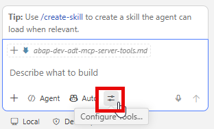

      Here, you see the **ADT MCP Server** node with a list of the available ADT MCP tools, e.g., 'abap_generators-list_generators', 'abap_creation-create_object', and so on.

      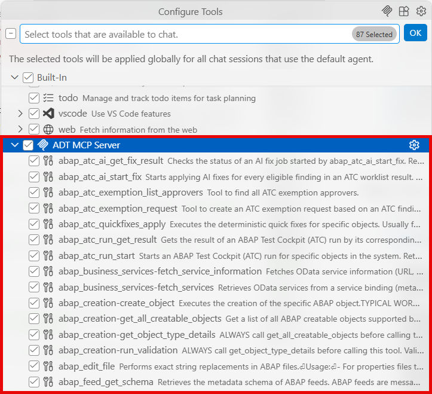

3. Check and ensure that the ADT MCP tools are **checked/enabled** in the list.
   
   > ℹ️ **Information**: 
   If you see the ADT MCP server and its ADT MCP tools are listed, your setup is complete!

</details>

---

## Summary & Next Exercise
[^Top of page](#)

Now that you've:
- Enabled and verified the ADT MCP server and ADT MCP tools

you can continue with the next exercise — **[Exercise 2: Generate the RAP UI Service with ADT MCP Tools and Preview the Travel App](../ex02/README.md)**

----
