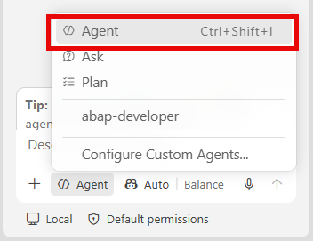
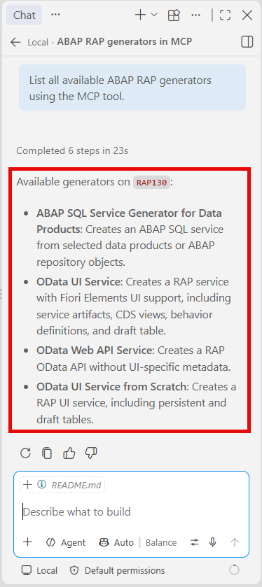
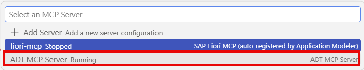
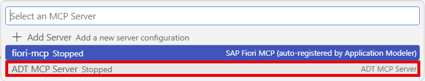
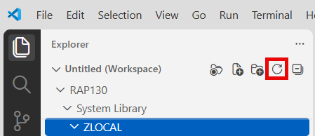

[Home - RAP130 - Build apps and web APIs with ABAP Cloud using agentic AI](../../README.md)

# Exercise 2: Generate the RAP UI Service with ADT MCP Tools and Preview the Travel App

## Introduction

The **ABAP Cloud Generator: OData UI Service from Scratch** ADT MCP tool generates a complete RAP UI service from a natural language description of the ABAP data model.  

It generates the following development objects:
- CDS view (interface view)
- CDS projection views (consumption view)
- CDS metadata extension (UI annotation)
- Database table
- Data element
- Behavior definition 
- Behavior implementation class
- Service definition
- Service binding
- ABAP class

In this hands-on session, the ABAP Cloud Generator is exposed with an underlying ADT MCP tool provided by 'ADT for Visual Studio Code' extension. This ADT MCP tool is exposed by the prompt which you will enter in the **Chat** view of the coding agent.

> ⚠ **Warning regarding AI outputs** ⚠
> The names of generated artifacts, database fields, and other elements may differ from those shown in this hands-on session, as they are generated by AI. **Always review the generated artifacts before continuing.**


### Exercises

- [2.1 - Generate the Transactional RAP UI Service](#exercise-21-generate-the-transactional-rap-ui-service)
- [Summary & Next Exercise](#summary--next-exercise)

> ℹ️ **Reminder**: Don't forget to replace all occurrences of the placeholder **`###`** with your group ID in the exercise steps below.

---

## Exercise 2.1: Generate the Transactional RAP UI Service
[^Top of page](#)

> Use ADT MCP tools to generate a complete RAP UI service as transactional OData UI service for **Travel** and **Booking** entities.

> ⚠ **Warning regarding AI outputs** ⚠
> Please be aware that the outputs generated by AI in this exercise description may differ from yours. **Always review the generated code and artifacts.**

<details>
  <summary>🔵 Click to expand!</summary>

### Step 1: Discover the available generators

1. In the **Chat** view (**`Ctrl+Shift+I`** macOS: **`Cmd+Shift+I`**), check if the **Agent** mode is set. To change the mode, choose the **Set agent** button from the bottom of the **Chat** view and select then **Agent**.

   

   > ℹ️ **Note**: It depends on your settings, if **Agent** or **Plan** mode is set. **Agent** performs the changes directly in your package. **Plan** simulates and displays possible changes. So, **Plan** gives you the chance to deny the changes before adapting the source code.

2. In the **Chat** view of your coding agent, type ...

   ```
   List all available ABAP RAP generators using the MCP tool.
   ```
   
   As a result, the relevant and available generators are listed and explained in the **Chat**.

   

   > ℹ️ **Note**:  In general, you can open a new chat if you have finished a development scenario and you want to start a new one. To do this, you can click the plus (+) icon from the toolbar on top of the **Chat** view.

<!--
### Step 2: Get the generator schema (optional)

3. To understand the required input parameters, you can ask your coding agent:

   ```
   Get the JSON schema for the OData UI Service from Scratch generator.
   ```
 -->

 <!--
 ### Step 2: Check Availability of the ADT MCP Server
3. Check if the ADT MCP servers are available. 

   a. Open the **Command Palette** (**`Ctrl+Shift+P`**).

   b. Type ...  
   ```
   >MCP:List Servers
   ```

   c. Select **'MCP: List Servers'** from the list.  

    You should then see an entry for **ADT MCP Server** in the quick pick list.
        
   

   d. **Optional**: If it is stopped, start the ADT MCP server. Select it and click **Start Server** .
    
   

   > ℹ️ **Note**: If no ADT MCP server is available, see [Exercise: Enable the ADT MCP Server in ABAP Development Tools for VS Code](https://developers.sap.com/hands-on sessions/abap-dev-adt-mcp-server-tools) hands-on session.
-->

3. Check and allow the 'abap_generators-get_schema' tool call. Review the schema. It shows what fields the generator expects (entity names, field lists, suffixes, etc.).

### Step 2: Run the generator

1. In the **Chat** view (**`Ctrl+Shift+I`**), copy and paste the following prompt. 

   > ℹ️ **Note**: Replace **`###`** with your group ID.

   ```markdown
   Generate the RAP UI service for travel management using the OData UI Service from Scratch generator.

   Use the following specification:
   - Add the objects to be created in package ZRAP130_### in the active destination.
   - Entity 1: Travel, based on the structure /DMO/TRAVEL_DATA
   - Entity 2: Booking, based on the structure /DMO/BOOKING_DATA (child of Travel)
   - All generated object names should use the suffix "###".
   - Generate ABAP Dictionary database tables as datasource.
   - Do not generate and use CDS table entities.
   - The software component is ZLOCAL. So, no transports are required.
   ```

   > ℹ️ **Note**: The number of the suffix can be found as group ID in the handout.

2. Run the prompt with **Enter**.

   Your coding agent starts the generation.

3. Process each tool call when the coding agent asks in the **Chat** view.

   > ℹ️ **Note**:  
   **Check and allow each tool call** when prompted.  
   The ABAP Cloud generator may take a moment to run. Progress will always be shown.  
   It will likely call:  
   >- 'abap_generators-get_schema' — to retrieve the generator input schema
   >- 'abap_generators-generate_objects' — to execute the generation


### Step 3: Review the generated objects

1. Once the generator completes, your coding agent will report the list of generated objects. 

   > ℹ️ **Note**: The name of the development objects will be generated by the coding agent. Consequently, the object names in the screenshots might differ from the names of your development objects.

   > You should see entries for:
   >- Business Services:  
         - Service definition: **ZUI_TRAVEL_04###** (SRVD)   
         - Service binding: **ZUI_TRAVEL_O4###** (SRVB)
   >- Core Data Services:  
         - Access Controls: **ZC_BOOKING_###, ZC_TRAVELL_###, ZR_BOOKING_###, ZR_TRAVELL_###**  (DCLS)  
         - Behavior Definitions: **ZC_TRAVEL###, ZR_TRAVEL###** (BDEF)  
         - Data Definitions: **ZC_BOOKING_###, ZC_TRAVELL_###, ZR_BOOKING_###, ZR_TRAVELL_###** (DDLS)  
         - Metadata Extensions: **ZC_BOOKING###, ZC_TRAVEL###** (DDLX)  
   >- Dictionary:  
         - Database Table: **ZBOOKING###, ZTRAVELL###, ZRBOOKING###, ZRTRAVELL###** (TABL)  
   >- SAP Object Type Management:   
         - SAP Object Node Types: **ZTRAVEL_###** (NONT)  
         - SAP Object Types: **ZTRAVEL__###** (RONT)  
   >- Source Code Library:   
         - Classes: **ZBP_C_TRAVEL###, ZBR_R_TRAVEL** (CLAS)  

   > ℹ️ **Note**: 
   >- If the development objects of the generated RAP UI service are not displayed in the structure of your ABAP package, you need to wait a moment or you can refresh the **Explorer**. Choose then the **Refresh Explorer** button from the integrated toolbar.  
    
   >- The exact artifact names may differ slightly—they are generated by AI and may vary.
   >- Currently, the **Database tables** node is missing under **ABAP Dictionary**.


2. In the **Explorer**, press **F5** to refresh your package **`ZRAP130_###`**. You should see all generated objects listed under their respective object type folders.

3. Navigate through the package and take a look on the generated development objects.

### Step 4: Activate all generated objects

1. If the generated objects have not been activated by default, activate all inactive objects at once using the keyboard shortcut **`Ctrl+Shift+F3`** (macOS: **`Cmd+Shift+F3`**) **or** use **`Activate All`** in the status bar on the bottom.

   
   
   A dialog shows all inactive objects. 

2. Select all and click **Activate**.

    > ⚠️ If some objects fail to activate, check the **Problems** panel (**`Ctrl+Shift+M`**) for error details. Fix any issues and activate again.

    > ℹ️ **Hint**: You can also ask your coding agent to activate via MCP: type 'Activate all objects in package ZRAP130_### using the MCP tool' and allow the 'abap_activate-objects' tool call.

</details>

---

## Summary & Next Exercise
[^Top of page](#)

Now that you've:
- Generated a complete transactional RAP UI service ('Travel' and 'Booking' entities) using the ADT MCP tools
- Activated all generated development objects

you can continue with the next exercise — **[Exercise 3: Publish and Preview the Travel App](../ex03/README.md)**

----
