[Home - RAP130 - Build apps and web APIs with ABAP Cloud using agentic AI](../../README.md)

# Exercise 3: Publish and Preview the Travel App

## Introduction

In this exercise, you will publish the local service endpoint of your OData V4 service binding and open the **Preview** in your default browser, to see the running Travel application.

---

### Exercises

- [3.1 - Publish the RAP UI Service](#exercise-31-publish-the-rap-ui-service)
- [3.2 - Preview the Travel App in the Browser](#exercise-32-preview-the-travel-app-in-the-browser)
- [Summary & Next Exercise](#summary--next-exercise)

> ℹ️ **Reminder**: Don't forget to replace all occurrences of the placeholder **`###`** with your group ID in the exercise steps below.

---

## Exercise 3.1: Publish the RAP UI Service
[^Top of page](#)

> Publish the local service endpoint of the service binding to make the OData service available for preview and consumption.

  
🔵 Click to expand!

1. Open the service binding using **`Ctrl+Shift+A`**.  

2. In the dialog to be opened, enter *`#type:SRVB`* and select the entry **Service Binding** (SRVB).

   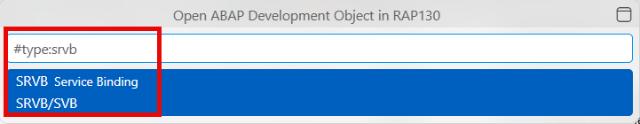

   > ℹ️ **Note**: You need to explicitly type the hash sign '#'. Otherwise, the object type cannot be found.

4. Search for the service binding using asterisk '*' and your group ID.

   > ℹ️ **Note**: The name of the development objects will be generated by the coding agent. Consequently, the object names in the screenshots might differ from the names of your development objects.

3. Open the service binding by clicking its ABAP File Format (AFF) part in the **Explorer**.

   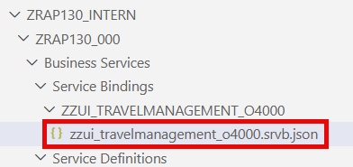

   > ℹ️ **Note**: Alternatively, you can open it directly from the *Business Services > Service Bindings* folder in your ABAP package.

4. To publish the RAP UI service, click the **Publish** code lens on top in the editor.

    > ℹ️ **Note**: The "Publish" action registers a local service endpoint that allows the  preview and external consumers to discover the service.  

    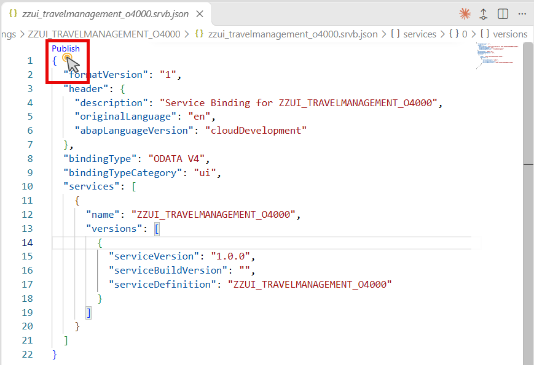

5. Wait for the publishing to be completed. 

   > ✅ You should see the progress information on the bottom in the status bar as follows: _Publish/unpublish action in progress_.

   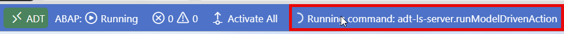

   > ✅ You see when the publish has finished as follows:
      - The **Publish** code lens turns to **Unpublish**.
      - The **Preview|Create a SAP Fiori App... |Test...|** code lens is displayed for the service.
   
   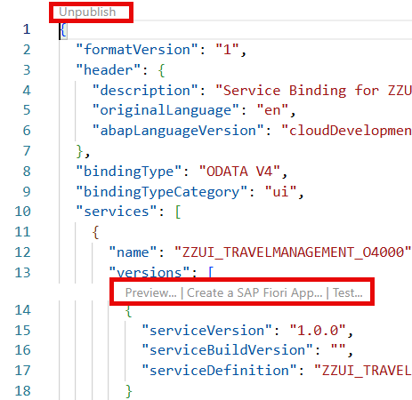
   

---

## Exercise 3.2: Preview the Travel App in the Browser
[^Top of page](#)

> Preview the app for the 'Travel' entity in your default browser.

  
🔵 Click to expand!

1. Open your service binding and click the **Preview** code lens in the source code.

   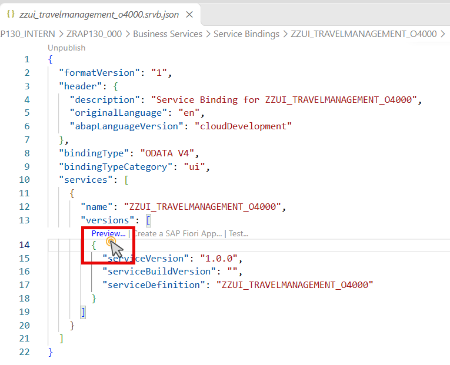

2. In the dialog to be opened, select the 'Travel' entity. 
   
   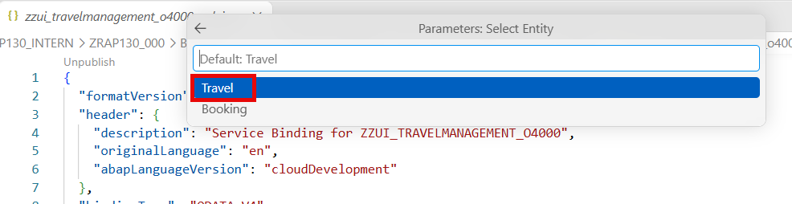

3. In the dialog to be opened of your operating system, choose **Open** to confirm opening the link in your default browser.

   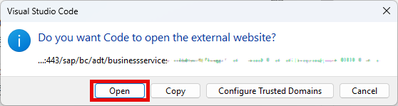

   Your default browser is opened and displays the landing page of your SAP Fiori app.  
   
   In detail, you see the **Preview** of your 'Travel' SAP Fiori app.

4. Create a new 'Travel' entity as follows:  

   a. In the table toolbar of your SAP Fiori app, choose **Create**.  

   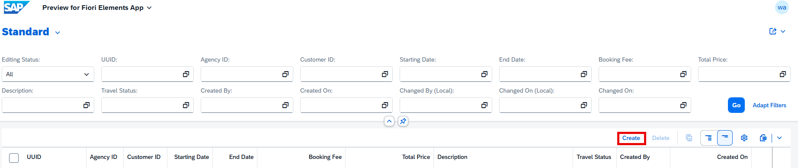

   b. In the generated 'Travel' entity to be opened, enter some fields, such as  **Starting Date**, **End Date**, **Booking Fee**, and **Total Price**.    

   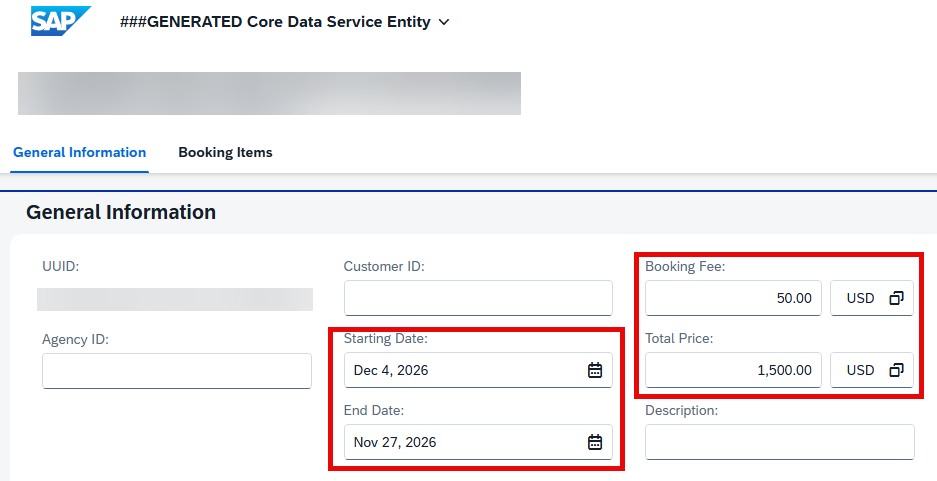

   b. Fill in **Agency ID** and **Customer ID**.
   
   > ℹ️ **Note**: Use any valid IDs from the [/DMO flight reference data](https://github.com/SAP-samples/abap-platform-refscen-flight), e.g., '070001' for **Agency**, '000001' for **Customer ID**.  

   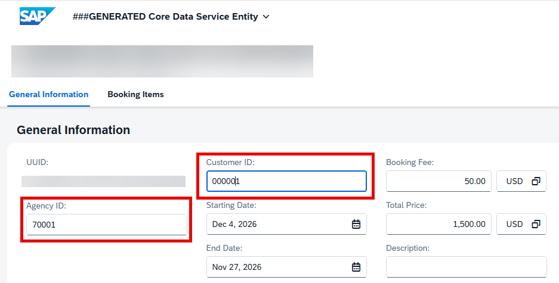
   
   c. Confirm with **Save** and navigate back to the landing page.  

   > ✅ If you can create and save a 'Travel' entry, the app is working correctly!

   The landing page displays your just created entry.

   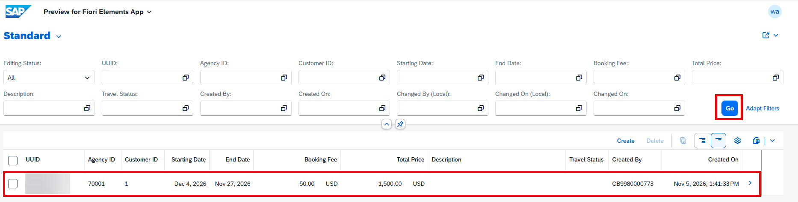

   > ℹ️ **Note**: In case your 'Travel' entry is not displayed, choose the **Go** button from the table toolbar to update the content.

---

## Summary & Next Exercise
[^Top of page](#)

Now that you've:
- Published the local service endpoint of the service binding
- Opened and tested the preview of the SAP Fiori app in the browser
- Created a test 'Travel' entry to verify the RAP UI service is working

You can continue with the next exercise — **[Exercise 4: Add a Validation](../ex04/README.md)**

---
